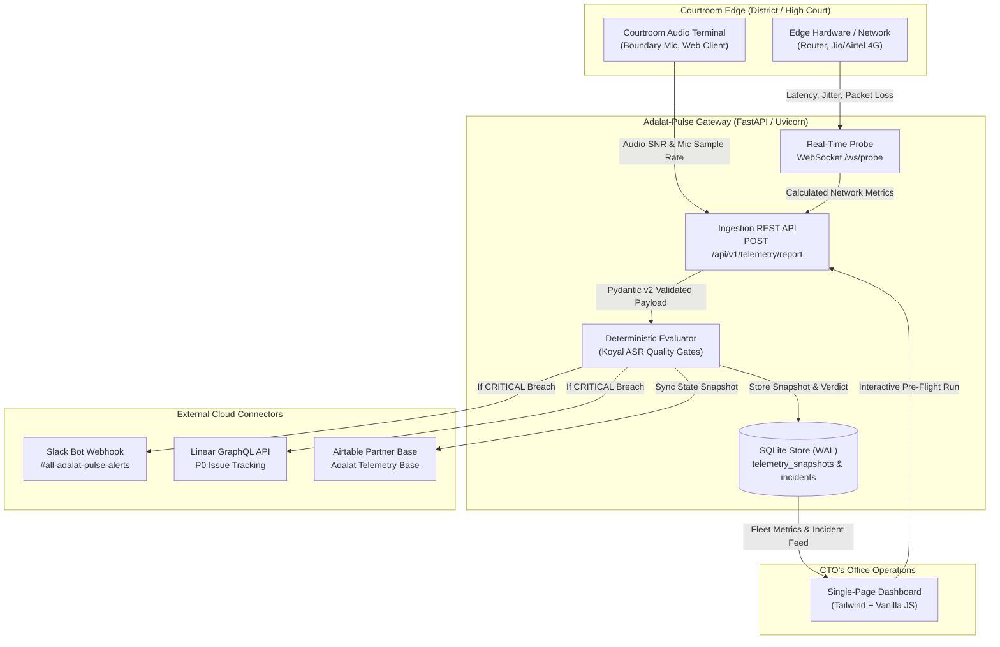

# SYSTEM ARCHITECTURE: ADALAT-PULSE
**Standard:** ASD-STE100 Simplified Technical English  
**Purpose:** 1-Page System Map for Whiteboard Defense  

---

## 1. High-Level System Diagram

---

## 2. Component Breakdown

### 1. Ingestion Layer (`src/main.py`)
- High-throughput asynchronous REST endpoint built with FastAPI.
- Validates all incoming payloads through compiled Pydantic v2 schemas (`src/models.py`).
- Hosts `/ws/probe` WebSocket endpoint to measure actual round-trip latency and jitter in real time.

### 2. Deterministic Evaluator (`src/evaluator.py`)
- Pure, side-effect-free evaluation function.
- Tests 6 parameters against strict Koyal ASR quality gates:
  1. Packet Loss ($\le 2.0\%$)
  2. Latency ($\le 300\text{ ms}$)
  3. Jitter ($\le 40\text{ ms}$)
  4. WebSocket Keepalive RTT ($\le 350\text{ ms}$)
  5. Microphone Sample Rate ($\ge 16\text{ kHz}$)
  6. Ambient Noise Floor SNR ($\ge 12\text{ dB}$)
- Emits three deterministic verdicts: `OPTIMAL`, `DEGRADED`, or `CRITICAL`.

### 3. Local Persistence Engine (`src/database.py`)
- Local SQLite database running in **WAL mode** (Write-Ahead Logging).
- Enables concurrent non-blocking reads and high-speed writes.
- Zero-config, deterministic, and easily backupable.

### 4. Automated Incident Router (`src/alerts.py`)
- Asynchronously routes critical failures without blocking telemetry ingestion.
- Formats Slack Block Kit payloads for `#all-adalat-pulse-alerts` with field operator remediation advice.
- Issues GraphQL mutations to Linear for P0 engineering issue creation.

### 5. Bi-Directional Airtable Sync (`src/airtable_sync.py`)
- Connects directly to Airtable REST API (`v0`).
- Performs upserts (checks `Courtroom ID` via filter formula; creates if new, patches if existing).
- Keeps partner court state visible to non-technical state coordinators.

### 6. Operations Dashboard (`src/static/`)
- Pure HTML5 + Vanilla ES6 + Tailwind CDN (zero `node_modules`).
- Uses browser Web Audio API (`AudioContext`, `AnalyserNode`) to measure actual microphone sample rates and room noise floors.
- Displays live 11-state matrix, health percentages, and incident feeds.
